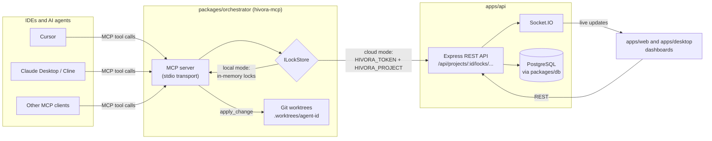

# Contributing to Hivora

Thanks for helping out! Hivora is in beta and welcomes bug reports, docs and code. Look for the `good first issue` and `help wanted` labels in the [issue tracker](https://github.com/Enard52/Hivora/issues).

## Getting set up

You need Node.js 18+, npm and Git. PostgreSQL 14+ is only needed if you run the API; Redis is optional. [SETUP.md](./SETUP.md) covers the database and AI provider configuration in detail.

```bash
git clone https://github.com/<your-username>/Hivora.git
cd Hivora
npm install
cp .env.example .env     # then edit DATABASE_URL and the other values you need
```

Run the pieces you are working on:

| Command | What it starts |
|---|---|
| `npm run dev:api` | Express API with Socket.IO (`apps/api`, default port 4000) |
| `npm run dev:web` | Next.js web app (`apps/web`) |
| `npm run dev:desktop` | Vite + Electron desktop app (`apps/desktop`) |
| `npm run dev:all` | API, web and desktop together |
| `npm run db:migrate` / `db:seed` / `db:studio` | Prisma helpers for `packages/db` |

To try the MCP server on its own, no API or database is needed:

```bash
npm run build --workspace packages/orchestrator
npm run start:mcp --workspace packages/orchestrator
```

Without `HIVORA_TOKEN` and `HIVORA_PROJECT` set, it runs in local mode with an in-memory lock store.

## Monorepo structure

This is an npm workspaces monorepo (`apps/*` and `packages/*`).

```
apps/
  api/            Express + Socket.IO backend: auth, projects, locks, agents
  web/            Next.js web app and Kanban board
  desktop/        Electron + Vite desktop app
packages/
  orchestrator/   MCP server and CLI (hivora-mcp): lock stores, git worktrees, apply_change
  shared/         Types, zod schemas and SDK shared by the apps
  db/             Prisma schema, client and seed script
  ui/             Shared React components (KanbanBoard, AgentList, LockManager, ...)
```

Inside `packages/orchestrator/src`:

- `mcp/server.ts`: the MCP server and its tools (`get_locks`, `lock_symbol`, `unlock_symbol`, `apply_change`, plus `get_pending_tasks`, `list_tasks`, `claim_task`, `complete_task` in cloud mode).
- `lock/`: the `ILockStore` interface with two implementations: `localLockStore` (in memory) and `cloudLockStore` (calls the API).
- `api/taskClient.ts`: HTTP client for tasks on the API.
- `git/worktree.ts`: creates an isolated git worktree per agent under `.worktrees/`.
- `operations/applyChange.ts`: lock, edit in the agent's worktree, commit, unlock.
- `cli.ts`: the `hivora-mcp` entry point (`start`, `tasks`, `diff`, `approve`, `reject`, `agent-mode`, `logs`).

## Architecture: how IDEs talk to Hivora

An IDE or agent (Cursor, Claude Desktop, Cline, ...) launches the orchestrator as an MCP server over stdio and calls its tools. The orchestrator checks locks, either locally or through the Hivora API, and the API pushes updates to the dashboards over Socket.IO.



Typical flow for one edit: the agent calls `lock_symbol` for a file and symbol, then `apply_change`, which edits and commits in that agent's own worktree, and finally `unlock_symbol`. Another agent asking for the same symbol while it is locked gets a failed lock result and can work on something else.

## Making a change

1. Fork the repo and create a branch from `main` (for example `fix/lock-ttl` or `docs/setup-typo`).
2. Keep the change focused: one fix or feature per pull request.
3. Run the checks that CI runs before you push:

   ```bash
   npm run typecheck
   npm run test:locks --workspace @hivora/orchestrator
   npm run test:worktree --workspace @hivora/orchestrator
   ```

   If you touched the web or API app, also run `npm run build --workspace apps/web` or `apps/api`.
4. Open a pull request against `main`. Describe what changed and why, link the issue (`Closes #123`), and say how you tested it. Screenshots help for UI changes.
5. Be ready for review feedback. Small, well-explained PRs get merged fastest.

## Reporting bugs and ideas

Open an issue with what you expected, what happened, and steps to reproduce (Node version, OS and which app or package). For larger features, please open an issue to discuss the approach before writing a lot of code.

## License

By contributing you agree that your contributions are licensed under the project's [Apache-2.0 license](./LICENSE).
